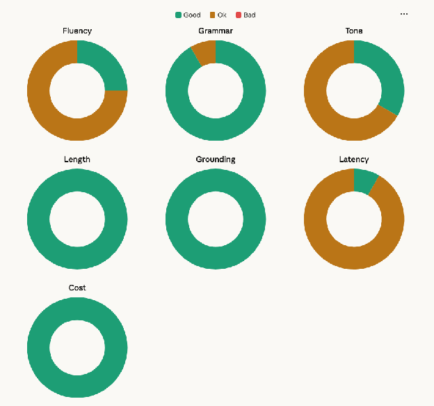

# Task 1

## Criterion definitions

| Criterion | Good | Ok | Bad |
| ----- | ----- | ----- | ----- |
| **Fluency** | Sentences flow naturally; transitions are smooth; easily readable; no awkward phrasing. | Some minor awkward phrasing or slightly unnatural sentence order; meaning still clear. | Frequent awkward phrasing; choppy or disjointed sentences; hard to read. |
| **Grammar** | No spelling, punctuation, or capitalization errors. | 1–2 minor errors per \~100 words; does not impede understanding. | Frequent spelling or punctuation errors; grammar issues interfere with comprehension. |
| **Tone** | Professional yet approachable, persuasive without being pushy, conveys value | Mostly professional but occasionally missing warmth or conviction | Sterile/robotic, overly aggressive, or mismatched to e-commerce context |
| **Length** | 50–90 words. | 40–49 or 91–110 words. | \<40 or \>110 words. |
| **Grounding** | All statements supported by provided information; no hallucinations or assumptions. | Mostly accurate; minor unsupported statements that do not change meaning. | Frequent unsupported claims; contradicts or invents information. |
| **Latency (avg. time per call)** | \<2000ms | 2000-5000ms | \>5000ms |
| **Cost (avg. price per call)** | \<$0.00002 | $0.00002-0.00005 | \>$0.00005 |

## Pass / fail definition

### Cumulative pass bar

At least four good ratings, no bad rating

### Go / no-go rules

Grounding \= Good  
Grammar \= Good

# Task 2

## Prompt

You are an expert e-commerce product description writer.  
 Your task is to craft persuasive, compelling product descriptions that engage customers and drive sales.

**REQUIREMENTS:**

* **Length:** Exactly 50–90 words.  
* **Tone:** Friendly, professional, and approachable, highlighting genuine value.  
* **Grounding:** Use **only** the information provided; do not invent features or specs.  
* **Grammar:** Perfect spelling, punctuation, and capitalization.  
* **Flow:** Sentences should read naturally, with smooth transitions and logical pacing.

**APPROACH:**

1. Identify the key selling points from the provided product attributes.  
2. Lead with the most compelling feature or use case.  
3. Use specific product details to support quality and value.  
4. Highlight material, craftsmanship, or warranty as trust signals.  
5. Close with a clear value statement.

**AVOID:**

* Unsupported superlatives (e.g., “the best” without context).  
* Unverified claims about performance or durability.  
* Generic or vague language that could describe any product.

Generate **only** the product description.

## 

## Model

We’ve chosen Meta-Llama-3.1-8B-Instruct	

## Baseline analysis

**Best performers** — Grounding and Length both scored 100% Good (12/12), making them the strongest criteria by a clear margin.

**Worst performer** — Latency, with only 1 out of 12 rated Good (8%) and the remaining 11 rated Ok. Fluency comes in second-worst at 25% Good (3/12).

# Task 5

## Model

We decided to switch to Qwen3-30B-A3B-Instruct-2507 since it is a bigger model, and therefore is more accurate at evaluation where costs and latency don’t really matter.

## Prompt

You are a strict but fair e-commerce content evaluator.  
You will be given a product's structured data and an AI-generated product description.  
Evaluate the description on five criteria using the rubric below.

Rubric:

Criterion | Good | Ok | Bad  
Fluency   | Sentences flow naturally; transitions are smooth; easily readable; no awkward phrasing. | Some minor awkward phrasing or slightly unnatural sentence order; meaning still clear. | Frequent awkward phrasing; choppy or disjointed sentences; hard to read.  
Grammar   | No spelling, punctuation, or capitalization errors. | 1–2 minor errors per \~100 words; does not impede understanding. | Frequent spelling or punctuation errors; grammar issues interfere with comprehension.  
Tone      | Professional yet approachable, persuasive without being pushy, conveys value | Mostly professional but occasionally missing warmth or conviction | Sterile/robotic, overly aggressive, or mismatched to e-commerce context  
Length    | 50–90 words. | 40–49 or 91–110 words. | \<40 or \>110 words.  
Grounding | All statements supported by provided information; no hallucinations or assumptions. | Mostly accurate; minor unsupported statements that do not change meaning. | Frequent unsupported claims; contradicts or invents information.

For each criterion output an explanation (your reasoning) FIRST, then a verdict of "good", "ok", or "bad".

# Task 6

## Sanity Check

Everything makes sense, but the generated description is very good already. So we mostly get “good” ratings.

## Full run

We’ve got 96% of descriptions that pass. The ones that fail fail mostly because of bad grounding.

## Compare to human evaluation

### Agreement rates:

Fluency: 25% (the judge scored all the outputs as good, while humans scored most of them as   
ok)  
Grammar: 92%  
Tone: 33% (same as fluency)  
Length: 100% (everything’s rated as good)  
Grounding: 100% (everything’s rated as good)

Most of them diverge on more subjective parts (such as tone and fluency).

### Criterion-by-criterion judging

### Analysis

1. Human evaluation is generally more accurate, especially on subtleties and on niche data, but it is much more expensive and less scalable. Usually it also loses consistency, when several people create the evaluations, which is unavoidable on big tasks.  
2. I’d recommend LLM-as-a-judge, but using the biggest and most expensive models, and after thoroughly crafting the judge and making sure it is aligned with human evaluations (humans and LLMs give similar same ratings for a similar subset of the data\_
